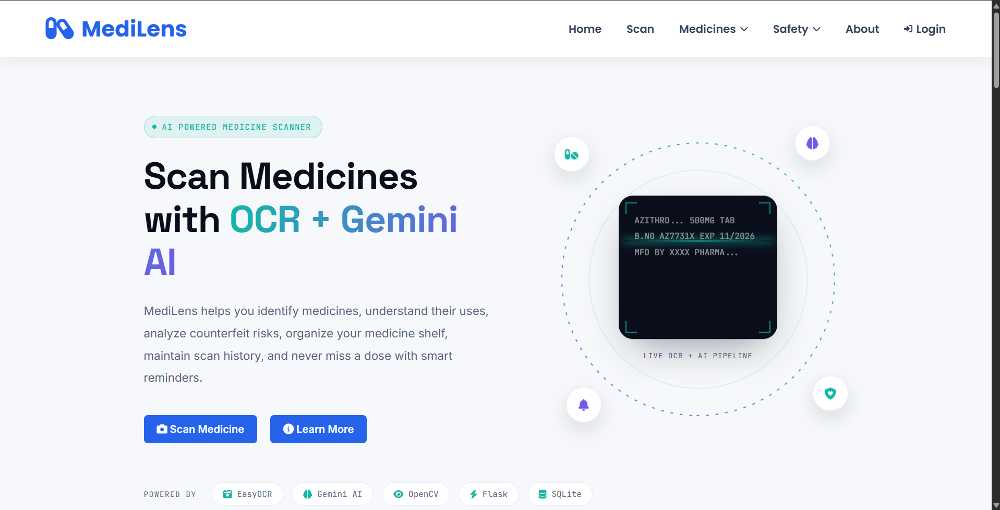
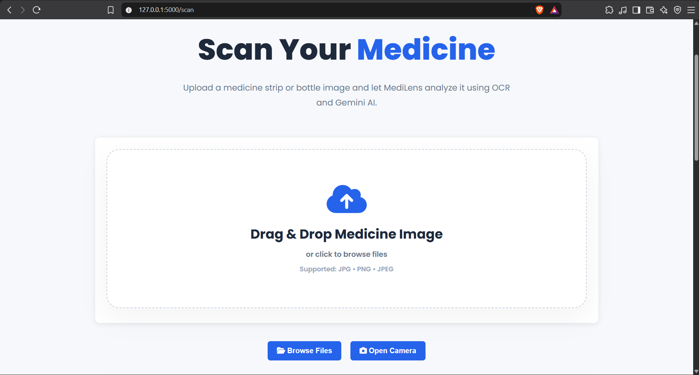
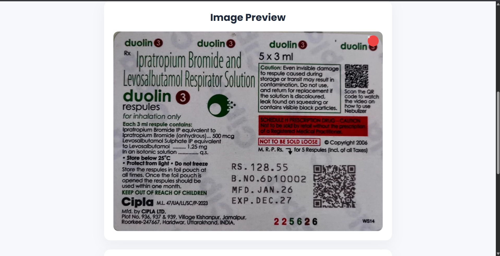
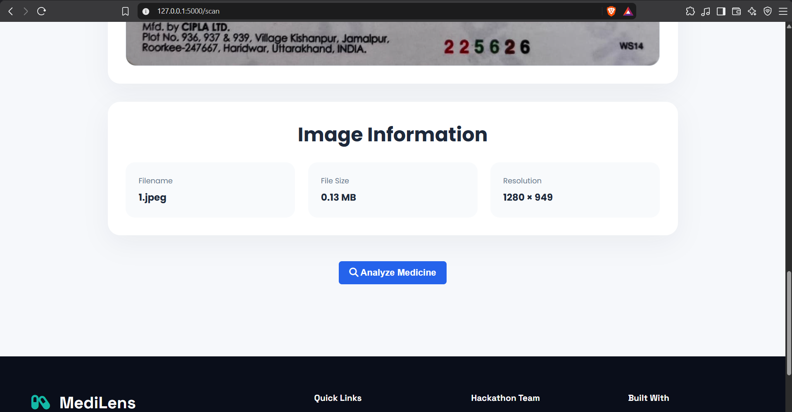
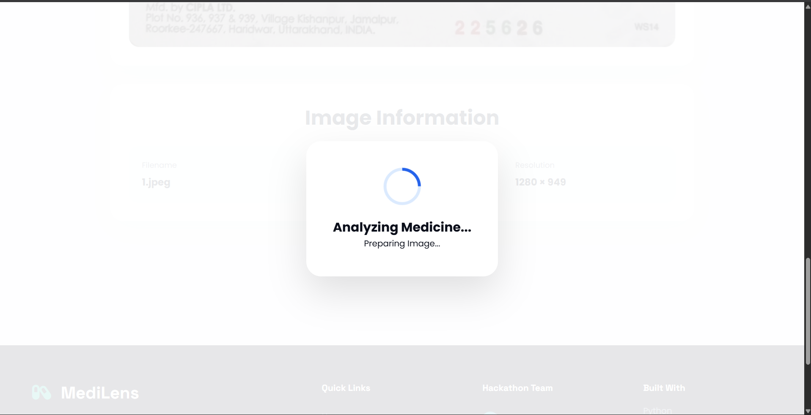
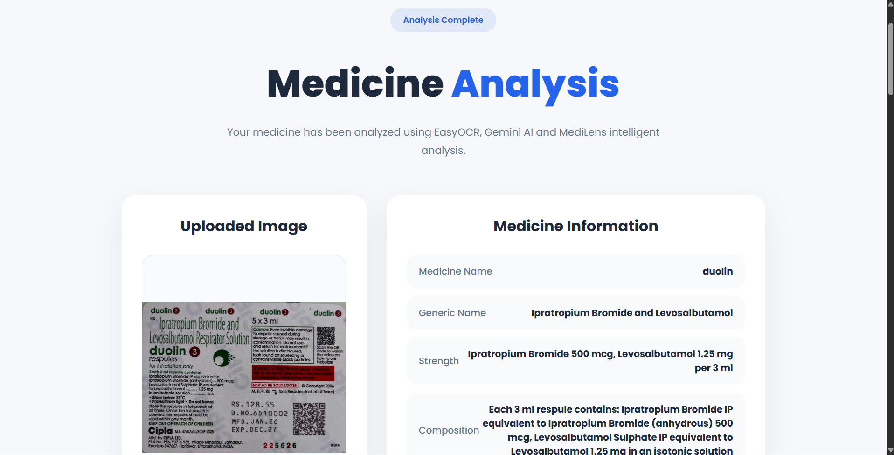
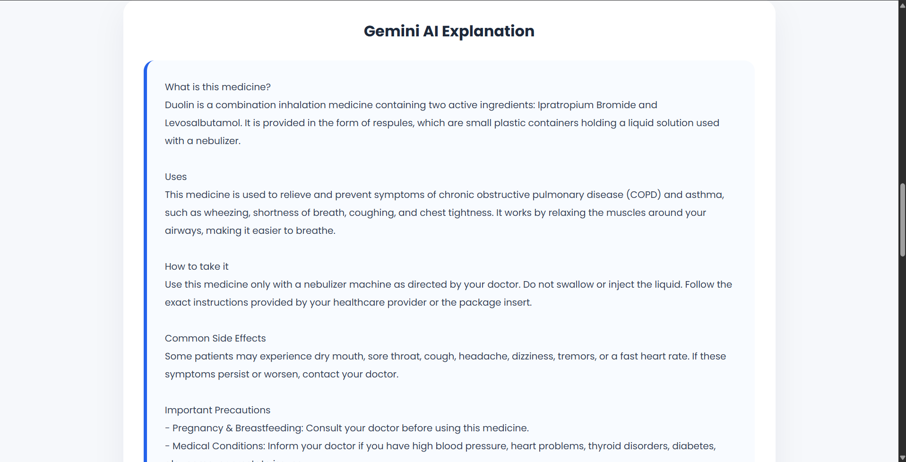
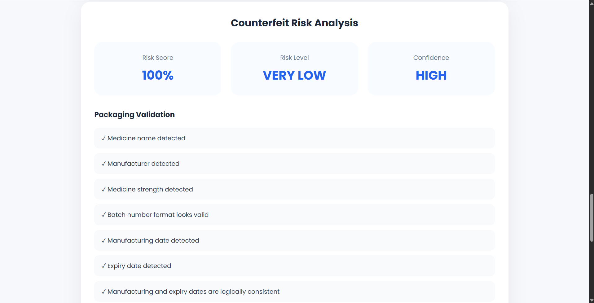

# 💊 MediLens

<p align="center">


</p>

<h3 align="center">
AI-Powered Medicine Scanner using PaddleOCR, EasyOCR, OpenCV & Gemini AI
</h3>

<p align="center">

Scan • Identify • Explain • Verify

</p>

---

# 📖 About

MediLens is an AI-powered medicine analysis web application that helps users scan medicine packaging using an image and automatically extract useful medicine information.

MediLens combines **PaddleOCR**, **EasyOCR**, **OpenCV**, and **Google Gemini AI** to analyze medicine packaging and provide structured medicine information, AI-generated explanations, and counterfeit-risk analysis.

The system uses **PaddleOCR as the primary OCR engine** and automatically falls back to **EasyOCR** when the primary OCR result is insufficient.

This project was built as a hackathon solution to make medicine information more accessible, understandable, and safer for everyone.

> ⚠️ **Disclaimer:** MediLens is an educational and hackathon project. Its results should not be considered a substitute for professional medical advice, diagnosis, or treatment.

---

# 🌟 Features

## 🔍 AI Medicine Scanner

- Upload medicine images
- Drag & drop image upload
- Camera-based image capture
- Automatic image preprocessing
- PaddleOCR primary text extraction
- EasyOCR fallback OCR
- OCR text cleaning and ranking
- AI-powered medicine recognition

---

## 💊 Medicine Information

MediLens can extract and structure information such as:

- Brand Name
- Generic Name
- Manufacturer
- Composition
- Strength
- Batch Number
- Manufacturing Date
- Expiry Date
- Dosage
- Storage Instructions
- Warnings
- Pack Size

---

## 🤖 Gemini AI Medicine Explanation

Gemini AI generates easy-to-understand medicine information including:

- What the medicine is
- Uses
- How to take it
- Common side effects
- Precautions
- Storage information
- Important notes

---

## 🛡 Counterfeit Risk Analysis

MediLens performs packaging-level validation using available medicine information.

It checks signals such as:

- Medicine name detected
- Manufacturer detected
- Medicine strength detected
- Batch number format
- Manufacturing date
- Expiry date
- Manufacturing/expiry date consistency
- Packaging information consistency
- Overall risk score
- Confidence level

> **Important:** The counterfeit analysis provides a risk assessment based on the available packaging information. It does not prove that a medicine is genuine or counterfeit.

---

## 📚 Medicine Shelf

Save medicines for future reference and organize scanned medicine records.

---

## 📜 Medicine History

Keep track of previously scanned medicines and access previous analysis results.

---

## ⏰ Medication Reminders

Create medication reminders to help users remember scheduled doses.

---

# 🖼 Screenshots

## 🏠 Home Page



---

## 📷 Medicine Scanner



---

## 🖼 Image Preview



---

## 📋 Image Information



---

## 🔄 Medicine Analysis



---

## 📊 Analysis Result



---

## 🤖 Gemini AI Explanation



---

## 🛡 Counterfeit Risk Analysis



---

# 🛠 Built With

## Backend

- Python
- Flask
- SQLAlchemy

## OCR & AI

- PaddleOCR
- EasyOCR
- Google Gemini AI

## Image Processing

- OpenCV
- Pillow

## Database

- SQLite

## Frontend

- HTML5
- CSS3
- JavaScript

---

# 🧠 OCR Architecture

MediLens uses a two-stage OCR pipeline.

```text
                    Medicine Image
                          │
                          ▼
                  OpenCV Preprocessing
                          │
                          ▼
                     PaddleOCR
                    Primary OCR
                          │
                          ▼
                Is OCR Result Sufficient?
                     /            \
                   YES             NO
                    │               │
                    │               ▼
                    │          EasyOCR
                    │          Fallback OCR
                    │               │
                    └───────┬───────┘
                            ▼
                    OCR Text Cleaning
                            │
                            ▼
                     OCR Line Ranking
                            │
                            ▼
                     Gemini AI Analysis
                            │
                            ▼
                  Structured Medicine Data
                            │
                            ▼
                  Counterfeit Risk Analysis
                            │
                            ▼
                       Final Result
````


# ⚙️ Installation

## 1. Clone Repository

```bash
git clone https://github.com/YOUR_USERNAME/MediLens.git
```

---

## 2. Move into Project

```bash
cd MediLens
```

---

## 3. Create Virtual Environment

### Windows

```bash
python -m venv venv
```

### Linux / macOS

```bash
python3 -m venv venv
```

---

## 4. Activate Virtual Environment

### Windows PowerShell

```powershell
venv\Scripts\activate
```

### Linux / macOS

```bash
source venv/bin/activate
```

---

## 5. Install MediLens Dependencies

```bash
pip install -r requirements.txt
```

---

# 🔧 PaddleOCR Setup

MediLens uses **PaddleOCR as the primary OCR engine**.

The PaddleOCR worker is located at:

```text
backend/workers/paddle_worker.py
```

The worker runs separately from the main Flask environment.

The tested development environment currently uses:

```text
Python             3.13.15
PaddleOCR          3.7.0
PaddlePaddle-GPU   3.3.1
```

The local PaddleOCR virtual environment is intentionally **not included in the Git repository**.

Detailed PaddleOCR setup information is available here:

```text
docs/paddleocr-setup.md
```

> **Development note:** The currently tested PaddleOCR environment is a local GPU environment. Production deployment will use a reproducible Linux/Docker GPU environment rather than relying on a developer's local virtual environment.

---

# 🔐 Environment Variables

Create a file named:

```text
.env
```

in the project root.

Add:

```env
GEMINI_API_KEY=YOUR_GEMINI_API_KEY

SECRET_KEY=YOUR_SECRET_KEY

DATABASE_URL=sqlite:///database/medilens.db
```

### Important

Never commit your `.env` file or API keys to GitHub.

---

# ▶️ Run Application

Start MediLens with:

```bash
python run.py
```

The application will be available at:

```text
http://127.0.0.1:5000
```

---

# 🧠 How It Works

### 1. Image Upload

The user uploads a medicine package image or captures an image using the camera.

### 2. Image Preprocessing

OpenCV prepares the image for OCR through preprocessing operations.

### 3. Primary OCR

PaddleOCR analyzes the primary image and extracts visible text.

### 4. OCR Sufficiency Check

MediLens evaluates whether the PaddleOCR result contains enough useful information.

### 5. OCR Fallback

If the PaddleOCR result is insufficient, EasyOCR is used as the fallback OCR engine.

### 6. OCR Cleaning

Detected text is cleaned, deduplicated, and normalized.

### 7. OCR Ranking

Important OCR lines are ranked using confidence scores and medicine-related keywords.

### 8. Gemini AI Extraction

The cleaned OCR information is sent to Gemini AI to extract structured medicine information.

### 9. AI Explanation

Gemini generates an easy-to-understand explanation of the medicine.

### 10. Counterfeit Risk Analysis

MediLens evaluates available packaging information and generates a counterfeit-risk assessment.

### 11. Medicine Record

The extracted medicine information can be stored in the local database.

### 12. Result Display

The final medicine information, AI explanation, and risk analysis are presented to the user.

---

# 📂 Project Structure

```text
MediLens/
│
├── assets/
│   └── logo.png
│
├── backend/
│   ├── models/
│   ├── routes/
│   ├── schema/
│   ├── services/
│   ├── utils/
│   ├── workers/
│   │   └── paddle_worker.py
│   ├── uploads/
│   ├── processed/
│   ├── app.py
│   ├── config.py
│   └── extensions.py
│
├── database/
│
├── docs/
│   ├── api.md
│   ├── architecture.md
│   ├── database.md
│   ├── paddleocr-setup.md
│   └── images/
│       ├── home.png
│       ├── scanner.png
│       ├── image-preview.png
│       ├── image-information.png
│       ├── analysis.png
│       ├── result.png
│       ├── ai-explanation.png
│       └── counterfeit.png
│
├── frontend/
│   ├── static/
│   │   ├── css/
│   │   ├── js/
│   │   └── images/
│   └── templates/
│
├── .env
├── .gitignore
├── LICENSE
├── Procfile
├── README.md
├── requirements.txt
└── run.py
```

> `venv/`, uploaded images, processed images, local experiments, and environment secrets are excluded from version control through `.gitignore`.

---

# 🚀 Future Improvements

* Barcode Scanner
* QR Code Verification
* Medicine Package QR Verification
* Mobile Application
* Cloud Database
* Multi-language Support
* Voice Assistant
* Doctor Portal
* Medicine Recommendation
* Drug Interaction AI
* Prescription Scanner
* Advanced packaging verification
* Pharmaceutical database integration
* Cloud GPU OCR deployment

---

# 👨‍💻 Team

## Sunny Verma

* OCR Pipeline
* PaddleOCR Integration
* EasyOCR Fallback
* OpenCV Image Processing
* Gemini AI Integration
* Backend Development

---

## Nikhil

* Medicine Shelf
* Medicine Database
* History Module

---

## Ankush

* Dashboard
* Safety Features
* UI Components

---

# 📜 License

This project is licensed under the MIT License.

See the `LICENSE` file for details.

---

# ❤️ Acknowledgements

* PaddleOCR
* PaddlePaddle
* EasyOCR
* Google Gemini AI
* OpenCV
* Flask
* SQLAlchemy
* Python Community

---

# ⭐ Support

If you like MediLens, please consider giving the project a ⭐ on GitHub.

It helps others discover the project and motivates us to keep improving MediLens.

````
